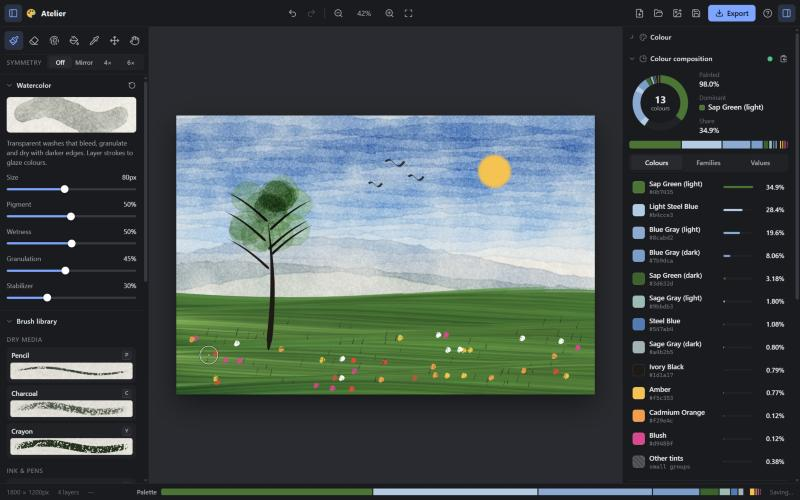

# Atelier — browser painting studio

A natural-media painting app built with **React + Vite + TypeScript** (pnpm), deployed to GitHub Pages.

**Live:** https://bonchan.github.io/drawing_tool/



## Features

### Brushes
Every brush is a small, real paint engine (not a stretched image stamp). All of them respond to pen pressure. Pencil and charcoal also respond to stylus tilt, and with a mouse the ink brush follows your speed.

| Group | Brushes |
| --- | --- |
| Dry media | **Pencil** (graphite that catches the paper grain), **Charcoal** (ragged, dusty), **Crayon** (waxy oil pastel) |
| Ink & pens | **Fineliner**, **Ink Brush** (tapered sumi strokes), **Calligraphy** (flat italic nib), **Marker** (builds up where strokes overlap), **Highlighter** (chisel tip, multiply) |
| Paint | **Round Brush**, **Watercolor / acuarela** (bleeding edges, darker dried rims, granulation, glazing), **Oil Paint** (bristle streaks, runs dry, picks up and blends canvas colour), **Airbrush** (builds up while held), **Spray Can** |
| Utility | **Eraser**, **Blender** (smudge), **Fill bucket** (tolerance, grow, sample all layers), **Eyedropper**, **Move layer**, **Pan** |

Each brush has its own settings (size, opacity, flow, stabilizer, plus brush-specific ones like wetness, granulation, nib angle, blending). The brush library shows a live preview drawn by the real engine, in your current colour.

### Layers
Add, duplicate, delete, clear, rename (double-click), show/hide, lock, **lock transparency** (paint only inside existing pixels, which is handy for colouring line art), reorder by drag and drop, merge down, per-layer opacity and 16 blend modes. The paper sits underneath as a background "layer": change its colour, toggle its cold-press texture, or hide it for a transparent export.

### Symmetry
Mirror, 4-way and 6-way radial painting around the canvas centre, with guides. It works with every brush; each mirrored copy keeps its own brush state, so ink tapers, bristles and blending behave correctly in every copy.

### Live colour composition
A panel that always shows **what percentage of the painting each colour takes up**, updating *while you paint*:

- A donut chart plus a ranked list of colour groups with names (pigment-style names such as *Ultramarine*, *Burnt Sienna*, *Sap Green*), hex codes and percentages. Click any colour to paint with it again.
- **Families** (reds, blues, browns, neutrals…), **Values** (a lightness histogram with shadows / midtones / highlights) and a **warm / cool / neutral** temperature split.
- Options: analyse all visible layers or just the active one, count the bare paper (on by default – its texture included, since it's part of what you see), and a *Detail* slider that merges similar tints or separates subtle shades. These settings, and the chosen tab, are remembered between visits.
- A thin palette strip in the status bar keeps the composition visible at all times.

How it works: the visible image is sampled on a grid using nearest-neighbour sampling, so the pixel colours are real and unblended. Colours are bucketed into a 15-bit histogram and grouped in the perceptual **OKLab** space (greedy seeding, then k-means refinement), all in a Web Worker. Matching then keeps each group's identity stable from one update to the next, so the chart animates instead of flickering.

### Languages
The whole interface is available in **English** and **Spanish** (*español*): every label, tooltip, brush description, colour name and number format (`12.5%` vs `12,5 %`). The language is detected from the browser, can be changed with the selector in the top bar, and is remembered. Auto-generated layer names follow the language ("Layer 2 copy" ↔ "Capa 2 copia"); names you typed yourself are never touched.

### Everything else
Undo/redo (80 steps, memory-capped; two-finger tap to undo on touch screens), pan/zoom (scroll, pinch, space-drag), straight lines with Shift-click, Alt/right-click colour picking, palm rejection (fingers pan once a stylus is used), autosave to IndexedDB, save/open `.atelier` project files, import images as layers (or drag and drop them), PNG export, keyboard shortcuts (press `?` in the app).

## Development

```bash
pnpm install
pnpm dev        # http://localhost:5173
pnpm test       # unit tests (vitest)
pnpm lint
pnpm build      # type-check + production build into dist/
```

## Adding a language

Translations live in `src/i18n/locales/`. English (`en.ts`) is the source catalog; every other locale is type-checked against it.

1. Copy `src/i18n/locales/es.ts` to `src/i18n/locales/<code>.ts` (e.g. `fr.ts`) and translate the strings. Keep the `{placeholders}` as they are.
2. Register it in `src/i18n/index.ts`:
   ```ts
   { code: 'fr', name: 'Français', load: () => import('./locales/fr') },
   ```
3. Run `pnpm typecheck` and `pnpm test`. TypeScript reports any missing or misspelled key, and the tests check that every locale has the same keys and placeholders as English.

Each locale is loaded on demand as its own small chunk. Plurals use CLDR categories (`plural({ one, few, many, other })`), so languages with richer plural rules work too. At runtime a missing string falls back to English, but the tests expect every catalog to be complete.

## Deployment

`.github/workflows/deploy.yml` builds every push to `main` and publishes `dist/` to the `gh-pages` branch, which GitHub Pages serves. The Vite `base` is relative (`./`), so the site works under any repository name.

## Project layout

```
src/
  engine/            canvas painting engine (framework-free)
    Engine.ts        document, layers, compositing, strokes, fill, history
    stroke.ts        input stabiliser, curve smoothing, dab spacing
    brushes/         one module per brush family
    textures.ts      procedural paper grain / noise, dab & grain caches
    brushPreview.ts  renders brush previews with the real engine
    persistence.ts   IndexedDB autosave + project files
  analysis/          colour composition (clustering, naming, worker)
  i18n/              translations: typed catalogs, plurals, number formats
  components/        React UI
  state/             small external stores (tools, view, UI)
```
